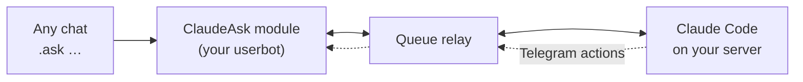

<div align="center">

# ClaudeAsk

**Claude inside your own Telegram chats — type `.ask`, and the answer appears in place of your message.**

[Install](#install) · [Commands](#commands) · [Triggers](#triggers-the-assistant-that-watches-a-chat) · [Remote userbot](#userbot-on-another-server) · [Troubleshooting](#troubleshooting)

Part of **[Telegram AI](https://github.com/maleon17/telegram-ai)** — Claude Code and Codex from Telegram, on your own subscription.

</div>

---

ClaudeAsk is a module for a Telegram **userbot** (your own account, automated) plus a Claude Code backend on your server. In any chat you write `.ask what does this error mean?` — your message turns into a live progress view and then into the answer, as if you had typed it yourself. There is no separate bot to talk to: it lives in the conversations you already have.



It runs on your Claude subscription through the official Claude Code CLI. The backend never holds your Telegram account: when Claude wants to *do* something in Telegram, the request goes back to your userbot, which performs it and reports the real result.

> Looking for a dedicated bot chat instead? That is **[Claude Telegram Bridge](https://github.com/maleon17/claude-telegram-bridge)**. Prefer Codex? **[CodexAsk](https://github.com/maleon17/codex-ask)** is the same thing with `.xask` — both can run side by side.

## What it can do

- **Answers in place**, in private chats and groups, with your chat's history as context.
- **Real Telegram actions** in your account: read and search chat history, send messages and files, create groups and invite people, manage contacts, forward messages.
- **Sees attachments**: replies to photos, documents, stickers and voice messages (voice is transcribed).
- **Remembers each chat** — a resumable Claude session per chat; `.new` starts over.
- **Triggers** — rules that watch a chat and react on their own (see below).
- **Stoppable** — `.stop` ends a request that is taking too long.

## Install

**You need:** a Linux server with `systemd`, `git` and Python 3.10+; the [Claude Code CLI](https://claude.com/claude-code) logged in with `claude auth login --claudeai`; and a [Heroku](https://github.com/coddrago/Heroku) userbot — the installer can create one for you in Docker.

**1. Install the backend:**

```bash
git clone https://github.com/maleon17/claude-ask.git
cd claude-ask
./setup.sh
```

The installer fetches the shared [telegram-ai-core](https://github.com/maleon17/telegram-ai-core) next to this folder, starts the queue relay and the Claude worker as services, and asks for:

- your name and Telegram ID (for the persona — get the ID from [@userinfobot](https://t.me/userinfobot));
- an **instance ID** — any short name for your userbot, like `mybot`.

At the end it prints the three commands you will paste into Telegram — **copy them now**, the token is shown only once.

**2. Get a userbot.** The installer's last question offers to create one: answer `1` for a local Docker userbot (you will sign in to Telegram once, right in the terminal), `2` if your userbot runs on another server (see [below](#userbot-on-another-server)), or `n` if you already have one on this server.

**3. Load the module and connect it.** Send `claude_ask.py` as a file to your **Saved Messages**, reply to it with `.lm`, then in the same private chat run the commands the installer printed:

```text
.asknet token <token>
.asknet local mybot
.asknet check
```

`.asknet check` should answer ✅. That's it — try `.ask hello` in any chat.

> Until the module is configured, every command answers with these setup instructions. All settings are also in the userbot's own editor: `.cfg ClaudeAsk`.

## Commands

| Command | What it does |
|---|---|
| `.ask <question>` | Ask Claude; reply to a message or file to include it |
| `.search <word>` | Find messages in this chat and answer about them |
| `.translate <text>` | Translate into Russian |
| `.stop` | Stop the running request in this chat (reply to its message to stop just that one) |
| `.new` | Forget this chat's conversation and start fresh |
| `.persona` | View or edit the assistant's persona; reply to a file or text to replace it, `.persona reset` to restore |
| `.asknet` | Connection settings: `token`, `local`, `tailnet`, `custom`, `check`, `testbot` |

## Triggers: the assistant that watches a chat

Ask in plain words — *"in this group, delete ads and messages with buttons"*, *"tell me when Alex replies"*, *"answer Alex for me until the question is settled"* — and Claude registers a trigger: a cheap filter (keywords, links, buttons, any message) plus what to do (notify you, reply, delete, post to a topic, run an agent, or ask you to confirm with buttons). Fuzzy conditions like "is this an ad?" are checked by a small model only for messages that passed the filter. Listing, editing and removing triggers also work in plain words.

Triggers run unattended, so they are deliberately limited: by default a trigger may only send a message to the chat it fired in, and it can never hand tasks to other agents.

## Userbot on another server

If your userbot runs elsewhere, the two servers talk over [Tailscale](https://tailscale.com):

1. On **this** server, answer `2` to the installer's last question — it installs Tailscale, logs this server into your tailnet and lets the relay listen there.
2. In the userbot, connect the module:
   ```text
   .asknet token <token>
   .asknet tailnet mybot http://<this-server-tailnet-ip>:9092
   ```
   The module installs Tailscale into the container by itself (once, about 30 MB, checksum-verified), starts it and replies with a login link. Open it, approve the device with the same Tailscale account as this server, then run `.asknet check`.

The container needs a persistent `/data` volume — the Heroku Docker image has one; Tailscale's state and binaries live there, so restarts and rebuilds reconnect on their own. If the node ever needs a new login, the link arrives in your Saved Messages. A Tailscale already in the image is used as is.

## Troubleshooting

| Symptom | What to check |
|---|---|
| `.ask` answers with setup instructions | The module is not configured yet: run the `.asknet` commands from the installer |
| `.asknet check` fails | It names the problem: no route to the backend, a wrong token, or a token of another instance |
| Stuck on "thinking" | `journalctl -u jarvis-ask-watcher -f` on the server; `.stop` ends the request |
| Telegram actions do nothing | `journalctl -u jarvis-ask-cmd-queue -f`; the userbot must be online to perform them |
| Lost the token | Run `./setup.sh` again with the same instance ID — it issues a new one |

<details>
<summary><b>Several userbots on one backend</b></summary>

Run `./setup.sh` again with another instance ID — for example for a family member's account. It reuses the running services and prints a new token for that userbot. The first instance runs on this server's own Claude login; each additional one gets an isolated Claude configuration and needs its own login (the installer prints the exact command), so nobody spends someone else's subscription.

One userbot can use the same instance ID for both ClaudeAsk and CodexAsk.

</details>

<details>
<summary><b>Together with the rest of Telegram AI</b></summary>

When other [Telegram AI](https://github.com/maleon17/telegram-ai) parts are installed on the same server, they connect on their own:

- **CodexAsk** shares the relay and the trigger rules; with the `JarvisAsk` coordinator loaded, one message fires one coordinated action instead of two.
- **Claude / Codex Telegram Bridge**: in your own `.ask` you can hand a bigger task to your coding agent in the bridge (it has your projects and no ten-minute limit) and get its answer back. Only the instance's owner can do this — never a trigger or another person. And in your bridge chat, the agent can act in your Telegram account through this userbot.

</details>

<details>
<summary><b>Updating</b></summary>

```bash
git pull && git -C ../telegram-ai-core pull
sudo systemctl restart jarvis-ask-watcher   # when no .ask is running
```

Reload the module in the userbot:

```text
.dlm https://raw.githubusercontent.com/maleon17/claude-ask/main/claude_ask.py
```

Settings survive module updates. `claude_ask.py` is generated from a template in telegram-ai-core — change it there, not here.

</details>

<details>
<summary><b>Settings, files and manual setup</b></summary>

- **Voice transcription** uses Mistral's Voxtral API: put a key into `.cfg ClaudeAsk` → `mistral_api_key`.
- **Persona**: `personas/<instance>.md` on the server (git-ignored), re-read automatically; the template is `personas/default.md.example`.
- **`jarvis.env`**: owner name and ID for the persona, chats where profanity is off (`JARVIS_NOMATS_CHAT_IDS`), the primary instance, the trigger classifier model (`CLAUDE_JARVIS_CLASSIFY_MODEL`, default `claude-haiku-5-5`).
- **Relay credentials, state directory, registry**: see [telegram-ai-core](https://github.com/maleon17/telegram-ai-core).
- **Unattended install**: every `setup.sh` question can be answered through the environment — the variables are listed at the top of the script.

Manual setup: install the relay from telegram-ai-core (`./install_relay.sh`, `./register_instance.sh <instance> <owner_id> ~/.config/telegram-ai/relay-token-claude.env`), then fill in the placeholders of `claude-jarvis-watcher.service.example` and enable it as `jarvis-ask-watcher.service`.

Tests: `./scripts/run_tests.sh` (the worker; the relay and module are tested in telegram-ai-core).

</details>

## License

MIT, Copyright (c) 2026 maleon17.
