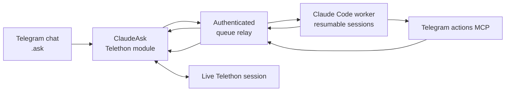

# ClaudeAsk

> Part of **[Telegram AI](https://github.com/maleon17/telegram-ai)** — Claude/Codex from dedicated bots or directly inside your Telegram account.

**Invoke Claude from an ordinary Telegram conversation, as your own account.**

ClaudeAsk combines a Telethon/Hikka userbot with a Claude Code worker and resumable per-chat sessions. Type `.ask` in a chat, the backend does the work, and the loaded module can use your live Telegram session for real actions such as reading history, searching chats, sending files or managing supported conversation workflows.

This is deliberately different from **[claude-telegram-bridge](https://github.com/maleon17/claude-telegram-bridge)**: there is no separate bot conversation acting as the UI. ClaudeAsk lives inside the conversations you already use.

## How it works



The important trust boundary is intentional: **the backend does not own your Telegram account**. Telegram actions are queued back to the module that holds the live Telethon session. The action gets a real result before the agent can treat it as completed.

The module submits `.ask` work to the relay's `/ask` endpoint. The worker returns progress and answers through `/tmp/jarvisask_ask_*`; MCP action calls use `/tmp/jarvisask_tool_queue` before the userbot executes them.

## What is included

- `claude_ask.py` — loadable ClaudeAsk userbot module
- `claude_watcher.py` — Claude Code backend with resumable sessions
- `mcp_telegram_tools.py` — launcher for the Telegram-action MCP implementation from the CodexAsk checkout
- `cmd_queue.py` — authenticated shared HTTP queue relay
- `setup.sh` and service examples — backend installation

## Commands

ClaudeAsk provides:

- `.ask` — ask Claude
- `.search` — search workflow
- `.translate` — translation workflow
- `.new` — reset/start a fresh Claude context

Network configuration is stored per userbot instance through `.asknet`.

Trigger rules live in the shared `ClaudeAsk` namespace, enabling coordination when both products and the optional `jarvis_ask.py` coordinator are loaded.

## Setup

Requirements:

- Linux with Python 3.10+
- Claude Code CLI authenticated with `claude auth login --claudeai`
- `systemd` and `sudo`
- a supported Telethon/Hikka userbot; this project targets [Heroku](https://github.com/coddrago/Heroku)

Heroku may run on the same host or in Docker on a separate host; the latter is a deployment choice, not a requirement.

```bash
git clone https://github.com/maleon17/claude-ask.git
cd claude-ask
chmod +x setup.sh
./setup.sh
```

`setup.sh` does everything on the backend side in one pass:

- creates the MCP virtual environment and `mcp_telegram_tools_config.json` (asks for the CodexAsk checkout's `telegram_actions_mcp.py`, or reads `JARVIS_TELEGRAM_MCP_PATH`)
- writes the persona env (`jarvis.env`)
- registers an owner and generates a relay token for an `instance_id` you choose (1–64 letters/digits/`_`/`-`, starting with a letter or digit), under [Relay authentication](#relay-authentication-and-trust-boundary) — printing the exact `.asknet` commands to paste into Telegram at the end
- installs and starts the `jarvis-ask-cmd-queue` and `jarvis-ask-watcher` systemd services (skipping either one that's already running, since both are shared infrastructure — safe to re-run for a second instance)
- optionally builds the graphify code map
- optionally builds and starts a local Docker userbot container (Heroku image, first-run Telegram sign-in included), or configures Tailscale on this host for a remote userbot

The only things it cannot do for you: the Claude Code login itself, and anything that has to happen inside Telegram (loading the module, running `.asknet`, the userbot's own first-time Telegram sign-in if you're not using the Docker option).

## Load the userbot module

Send `claude_ask.py` as a document to the userbot's test channel and reply with:

```text
.lm
```

Then run the `.asknet` command `setup.sh` printed for you (or, if you skipped instance setup, generate it manually first — see [Relay authentication](#relay-authentication-and-trust-boundary)):

```text
.asknet token <token>
.asknet local <instance_id>
```

or, for a remote backend:

```text
.asknet tailnet <instance_id> <backend_url>
```

Send the token command in a private chat, not a group. A single userbot can share the same `instance_id`/token between ClaudeAsk and CodexAsk; separate userbots each need their own.

### Remote userbot over Tailscale

The **remote userbot container** must also have `tailscale` and `tailscaled` installed and join the same tailnet. Install the package in its Docker image so container recreation does not remove the binaries. For an Ubuntu/Debian-based image, add a build step like this before starting Heroku:

```dockerfile
RUN apt-get update && apt-get install -y --no-install-recommends curl ca-certificates \
    && curl -fsSL https://tailscale.com/install.sh -o /tmp/tailscale-install.sh \
    && sh /tmp/tailscale-install.sh \
    && rm /tmp/tailscale-install.sh
```

The Ask module starts `tailscaled` in [userspace networking mode](https://tailscale.com/docs/concepts/userspace-networking) on module load, with an HTTP proxy at `localhost:1056`. It requires a persistent `/data` mount for `/data/tailscale/tailscaled.state`. Set `.asknet tailnet <instance_id> http://<backend-tailnet-ip>:9092` and `.asknet token <token>`, then reload the module so `client_ready` starts the local Tailscale proxy. Run the first interactive login inside that container:

```bash
docker exec -it <userbot-container> tailscale --socket=/var/run/tailscale/tailscaled.sock up
```

Open the URL Tailscale prints and approve the device. The module can restart a previously authenticated daemon, but it cannot install Tailscale or perform the first login for you.

The saved network settings survive later module updates.

Verify `.ask`, `.new`, and at least one request that uses a real Telegram tool such as `list_triggers`, `read_history`, or `search_chat`.

## Relay authentication and trust boundary

The relay requires:

- `JARVIS_RELAY_TOKENS_FILE` (default `/etc/jarvis-ask/relay-tokens.json`): server-side mapping of `sha256(token)` to `instance_id`
- `JARVIS_RELAY_OWNERS_FILE` (default `/etc/jarvis-ask/relay-owners.json`): server-side mapping of `instance_id` to Telegram owner ID

Both live outside the checkout with mode `0600`. `setup.sh` registers the owner and generates the token for you (and restarts the relay so it takes effect); the token is printed once and never stored anywhere in plaintext. To add another instance later, re-run `setup.sh` — it reuses the already-running relay and watcher rather than reinstalling them. To do this by hand instead, see [Manual setup](#manual-setup-without-setupsh).

The authenticated userbot reports `requester_id`. The relay cannot independently prove the original Telegram sender, so the authenticated userbot remains an explicit trust boundary. Owner authorization is nevertheless derived server-side from the token's instance mapping; the client cannot simply claim to be the owner.

Requests, tools, results, personas, resets and registered download artifacts are scoped by instance.

## Network configuration

`JARVIS_RELAY_BIND` controls relay listen addresses and defaults safely to `127.0.0.1`.

`CLAUDE_JARVIS_BACKEND_URL` configures the queue relay's network address for the module.

Local watcher/MCP processes receive either:

- `JARVIS_RELAY_TOKEN` for one instance, or
- `JARVIS_RELAY_TOKENS_JSON` for an instance-to-token map.

Do not store these secrets in the repository.

Voice transcription reads its Mistral key first from `/data/mistral_api_key.txt`, then falls back to `MISTRAL_API_KEY` in the environment. Keep either source outside the repository.

## Manual setup (without setup.sh)

Everything `setup.sh` automates, as raw commands, for anyone who wants full control or is scripting a different deployment.

Python dependencies and MCP config:

```bash
python3 -m venv .venv
.venv/bin/python -m pip install --upgrade pip
.venv/bin/python -m pip install -r requirements.txt -r requirements-mcp.txt
sed -e "s|__MCP_PYTHON__|$PWD/.venv/bin/python|g" -e "s|__INSTALL_DIR__|$PWD|g" \
    mcp_telegram_tools_config.json.example > mcp_telegram_tools_config.json
mkdir -p runtime && chmod 700 runtime
```

Relay token and owner, for an instance named `mybot`:

```bash
sudo mkdir -p /etc/jarvis-ask
python3 - <<'PY'
import json, os
path = "/etc/jarvis-ask/relay-owners.json"
data = json.load(open(path)) if os.path.exists(path) else {}
data["mybot"] = 123456789  # your numeric Telegram ID
json.dump(data, open(path, "w"), indent=2)
os.chmod(path, 0o600)
PY
sudo env JARVIS_RELAY_TOKENS_FILE=/etc/jarvis-ask/relay-tokens.json \
  python3 cmd_queue.py --add-token mybot
```

The token is printed once; save it. Write it where the watcher can read it:

```bash
echo "JARVIS_RELAY_TOKEN=<printed token>" | sudo tee /etc/jarvis-ask/relay-token.env
sudo chmod 600 /etc/jarvis-ask/relay-token.env
```

systemd services, after replacing `__USER__`, `__INSTALL_DIR__`, `__VENV_PYTHON__` ($PWD/.venv/bin/python) and `__JARVIS_TELEGRAM_MCP_PATH__` (path to CodexAsk's `telegram_actions_mcp.py`) in the two `.service.example` files:

```bash
sudo install -m 0644 claude-jarvis-queue.service.example /etc/systemd/system/jarvis-ask-cmd-queue.service
sudo install -m 0644 claude-jarvis-watcher.service.example /etc/systemd/system/jarvis-ask-watcher.service
sudo systemctl daemon-reload
sudo systemctl enable --now jarvis-ask-cmd-queue.service jarvis-ask-watcher.service
```

Skip the first `install`/`enable` if `jarvis-ask-cmd-queue.service` is already running for this deployment — it's shared infrastructure; do not run two copies. If you add a token to an already-running relay, restart it (`sudo systemctl restart jarvis-ask-cmd-queue.service`) — it only reads the tokens/owners files at startup.

Local Docker userbot, without the `scripts/setup_userbot_network.sh` wrapper: copy `deploy/userbot/{Dockerfile,entrypoint.sh,compose.yaml}` into a project directory, set `USERBOT_TG_ID` in a `.env` file next to them, put `claude_ask.py` under `modules/ClaudeAsk.py`, then `docker compose up -d --build` and attach once (`docker attach --sig-proxy=false --detach-keys=ctrl-p,ctrl-q <container>`) to complete Heroku's Telegram sign-in. For a remote userbot, see [Remote userbot over Tailscale](#remote-userbot-over-tailscale) above — those commands don't depend on any script either.

Then continue from [Load the userbot module](#load-the-userbot-module).

## Updating

Reinstall the current module from `main` with:

```text
.dlm https://raw.githubusercontent.com/maleon17/claude-ask/main/claude_ask.py
```

A plain `docker cp` does not reload an already-running module. `.asknet` configuration persists in the userbot database.

## Verification

```bash
./scripts/run_tests.sh
systemctl status jarvis-ask-watcher
journalctl -u jarvis-ask-watcher -f
```

`requirements-dev.txt` declares pytest. CI runs the test suite without requiring secrets or live Telegram services.

## ClaudeAsk + CodexAsk

ClaudeAsk and **[CodexAsk](https://github.com/maleon17/codex-ask)** are independent agent backends with separate histories, but intentionally share selected infrastructure and trigger coordination.

When both modules and the optional `jarvis_ask.py` coordinator are loaded, it chooses one trigger action per incoming message. Without it, the modules retain their separate legacy trigger handling.

For the wider picture, see **[Telegram AI](https://github.com/maleon17/telegram-ai)**.

## License

MIT, Copyright (c) 2026 maleon17.
