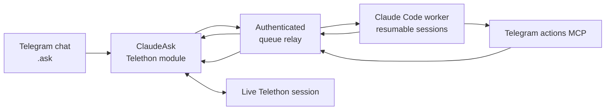

# ClaudeAsk

> Part of **[Telegram AI](https://github.com/maleon17/telegram-ai)** — Claude/Codex from dedicated bots or directly inside your Telegram account.

**Invoke Claude from an ordinary Telegram conversation, as your own account.**

ClaudeAsk combines a Telethon/Hikka userbot with a Claude Code worker and resumable per-chat sessions. Type `.ask` in a chat, the backend does the work, and the loaded module can use your live Telegram session for real actions such as reading history, searching chats, sending files or managing supported conversation workflows.

This is deliberately different from **[claude-telegram-bridge](https://github.com/maleon17/claude-telegram-bridge)**: there is no separate bot conversation acting as the UI. ClaudeAsk lives inside the conversations you already use.

## How it works



The important trust boundary is intentional: **the backend does not own your Telegram account**. Telegram actions are queued back to the module that holds the live Telethon session. The action gets a real result before the agent can treat it as completed.

The module submits `.ask` work to the relay's `/ask` endpoint. The worker returns progress and answers through `/tmp/jarvisask_ask_*`; MCP action calls use `/tmp/jarvisask_tool_queue` before the userbot executes them.

## What is included

- `claude_ask.py` — loadable ClaudeAsk userbot module
- `claude_watcher.py` — Claude Code backend with resumable sessions
- `mcp_telegram_tools.py` — launcher for the Telegram-action MCP implementation from the CodexAsk checkout
- `cmd_queue.py` — authenticated shared HTTP queue relay
- `setup.sh` and service examples — backend installation

## Commands

ClaudeAsk provides:

- `.ask` — ask Claude
- `.search` — search workflow
- `.translate` — translation workflow
- `.new` — reset/start a fresh Claude context

Network configuration is stored per userbot instance through `.asknet`.

Trigger rules live in the shared `ClaudeAsk` namespace, enabling coordination when both products and the optional `jarvis_ask.py` coordinator are loaded.

## Setup

Requirements:

- Linux with Python 3.10+
- Claude Code CLI authenticated with `claude auth login --claudeai`
- `systemd`
- a supported Telethon/Hikka userbot; this project targets [Heroku](https://github.com/coddrago/Heroku)

Heroku may run on the same host or in Docker on a separate host; the latter is a deployment choice, not a requirement.

Install and start the userbot using Heroku's own instructions before loading `claude_ask.py`.

Install the backend:

```bash
git clone https://github.com/maleon17/claude-ask.git
cd claude-ask
chmod +x setup.sh
./setup.sh
```

ClaudeAsk currently uses the CodexAsk checkout's `telegram_actions_mcp.py`; `setup.sh` asks for that path or reads `JARVIS_TELEGRAM_MCP_PATH`.

The installer creates the MCP virtual environment, `mcp_telegram_tools_config.json` and a runtime directory. Replace `__USER__` and `__INSTALL_DIR__` in the service templates before enabling them.

The queue relay is shared infrastructure. If `jarvis-ask-cmd-queue.service` is already running for the same deployment, do not launch a second copy on the same ports/directories.

## Load the userbot module

Send `claude_ask.py` as a document to the userbot's test channel and reply with:

```text
.lm
```

Configure the instance once:

Choose `<instance_id>` yourself (for example, `mybot`). Generate `<token>` on the backend with `cmd_queue.py --add-token` as shown under [Relay authentication](#relay-authentication-and-trust-boundary). Use the same ID in both commands.

```text
.asknet token <token>
.asknet local <instance_id>
```

or, for a remote backend:

```text
.asknet tailnet <instance_id> <backend_url>
```

### Remote userbot over Tailscale

The **remote userbot container** must also have `tailscale` and `tailscaled` installed and join the same tailnet. Install the package in its Docker image so container recreation does not remove the binaries. For an Ubuntu/Debian-based image, add a build step like this before starting Heroku:

```dockerfile
RUN apt-get update && apt-get install -y --no-install-recommends curl ca-certificates \
    && curl -fsSL https://tailscale.com/install.sh -o /tmp/tailscale-install.sh \
    && sh /tmp/tailscale-install.sh \
    && rm /tmp/tailscale-install.sh
```

The Ask module starts `tailscaled` in [userspace networking mode](https://tailscale.com/docs/concepts/userspace-networking) on module load, with an HTTP proxy at `localhost:1056`. It requires a persistent `/data` mount for `/data/tailscale/tailscaled.state`. Set `.asknet tailnet <instance_id> http://<backend-tailnet-ip>:9092` and `.asknet token <token>`, then reload the module so `client_ready` starts the local Tailscale proxy. Run the first interactive login inside that container:

```bash
docker exec -it <userbot-container> tailscale --socket=/var/run/tailscale/tailscaled.sock up
```

Open the URL Tailscale prints and approve the device. The module can restart a previously authenticated daemon, but it cannot install Tailscale or perform the first login for you.

The saved network settings survive later module updates.

Verify `.ask`, `.new`, and at least one request that uses a real Telegram tool such as `list_triggers`, `read_history`, or `search_chat`.

## Relay authentication and trust boundary

The relay requires:

- `JARVIS_RELAY_TOKENS_FILE`: server-side mapping of `sha256(token)` to `instance_id`
- `JARVIS_RELAY_OWNERS_FILE`: server-side mapping of `instance_id` to Telegram owner ID

Both should live outside the checkout with mode `0600`.

For an instance named `mybot`, set `/etc/jarvis-ask/relay-owners.json` to `{"mybot": 123456789}` (or add this entry to the existing JSON object). Replace the number with your numeric Telegram user ID. Then generate its token on the backend host:

```bash
sudo env JARVIS_RELAY_TOKENS_FILE=/etc/jarvis-ask/relay-tokens.json \
  python3 cmd_queue.py --add-token mybot
```

The token is printed once. Enter it with `.asknet token <token>`, then restart the relay to load the new token and owner mapping.

The authenticated userbot reports `requester_id`. The relay cannot independently prove the original Telegram sender, so the authenticated userbot remains an explicit trust boundary. Owner authorization is nevertheless derived server-side from the token's instance mapping; the client cannot simply claim to be the owner.

Requests, tools, results, personas, resets and registered download artifacts are scoped by instance.

## Network configuration

`JARVIS_RELAY_BIND` controls relay listen addresses and defaults safely to `127.0.0.1`.

`CLAUDE_JARVIS_BACKEND_URL` configures the queue relay's network address for the module.

Local watcher/MCP processes receive either:

- `JARVIS_RELAY_TOKEN` for one instance, or
- `JARVIS_RELAY_TOKENS_JSON` for an instance-to-token map.

Do not store these secrets in the repository.

Voice transcription reads its Mistral key first from `/data/mistral_api_key.txt`, then falls back to `MISTRAL_API_KEY` in the environment. Keep either source outside the repository.

## Updating

Reinstall the current module from `main` with:

```text
.dlm https://raw.githubusercontent.com/maleon17/claude-ask/main/claude_ask.py
```

A plain `docker cp` does not reload an already-running module. `.asknet` configuration persists in the userbot database.

## Verification

```bash
./scripts/run_tests.sh
systemctl status jarvis-ask-watcher
journalctl -u jarvis-ask-watcher -f
```

`requirements-dev.txt` declares pytest. CI runs the test suite without requiring secrets or live Telegram services.

## ClaudeAsk + CodexAsk

ClaudeAsk and **[CodexAsk](https://github.com/maleon17/codex-ask)** are independent agent backends with separate histories, but intentionally share selected infrastructure and trigger coordination.

When both modules and the optional `jarvis_ask.py` coordinator are loaded, it chooses one trigger action per incoming message. Without it, the modules retain their separate legacy trigger handling.

For the wider picture, see **[Telegram AI](https://github.com/maleon17/telegram-ai)**.

## License

MIT, Copyright (c) 2026 maleon17.
