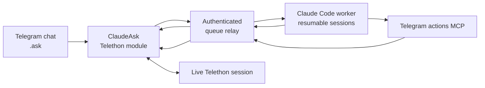

# ClaudeAsk

> Part of **[Telegram AI](https://github.com/maleon17/telegram-ai)** — Claude/Codex from dedicated bots or directly inside your Telegram account.

**Invoke Claude from an ordinary Telegram conversation, as your own account.**

ClaudeAsk combines a Telethon/Hikka userbot module with a Claude Code worker and resumable per-chat sessions. Type `.ask` in a chat, the backend does the work, and the loaded module can use your live Telegram session for real actions such as reading history, searching chats, sending files or managing supported conversation workflows.

This is deliberately different from **[claude-telegram-bridge](https://github.com/maleon17/claude-telegram-bridge)**: there is no separate bot conversation acting as the UI. ClaudeAsk lives inside the conversations you already use.

## How it works



The important trust boundary is intentional: **the backend does not own your Telegram account**. Telegram actions are queued back to the module that holds the live Telethon session. The action gets a real result before the agent can treat it as completed.

## What is included

- `claude_watcher.py` — Claude Code backend worker with resumable sessions
- `claude_ask.py` — the loadable userbot module (generated; see below)
- `personas/` — the persona template
- `setup.sh` and the service example — backend installation

The queue relay, the Telegram-action MCP server and the source of the userbot module live in **[telegram-ai-core](https://github.com/maleon17/telegram-ai-core)**, shared with [CodexAsk](https://github.com/maleon17/codex-ask). `setup.sh` fetches it for you. `claude_ask.py` here is built from the template there — do not edit it by hand.

## Commands

- `.ask <question>` — ask Claude
- `.search <word>` — search the chat and answer
- `.translate <text>` — translate
- `.stop` — stop the request in this chat (as a reply to its message: only that one)
- `.new` — start a fresh Claude context
- `.persona` — view or replace the persona
- `.asknet` — connection settings; `.asknet check` verifies them

Trigger rules live in the shared `ClaudeAsk` namespace, enabling coordination when CodexAsk and the optional `jarvis_ask.py` coordinator are also loaded.

## Setup

Requirements:

- Linux with Python 3.10+ (and its `venv` module), `git`
- Claude Code CLI authenticated with `claude auth login --claudeai`
- `systemd` and `sudo` (only to install the service units)
- a supported Telethon/Hikka userbot; this project targets [Heroku](https://github.com/coddrago/Heroku)

Nothing else from this ecosystem has to be installed first. Heroku may run on the same host or in Docker on a separate host.

```bash
git clone https://github.com/maleon17/claude-ask.git
cd claude-ask
./setup.sh
```

`setup.sh` does everything on the backend side in one pass:

- finds `telegram-ai-core` next to this checkout, or clones it there, and installs the queue relay from it (a relay that is already running is left alone)
- writes the persona env (`jarvis.env`), keeping any other keys already in that file
- registers an owner and generates a relay token for an `instance_id` you choose (1–64 letters/digits/`_`/`-`, starting with a letter or digit), then prints the exact `.asknet` commands to paste into Telegram
- installs and starts the `jarvis-ask-watcher` service
- optionally builds the graphify code map
- optionally builds and starts a local Docker userbot container (Heroku image, first-run Telegram sign-in included), or configures Tailscale on this host for a remote userbot

Every question can also be answered through environment variables (listed at the top of `setup.sh`), so the install can run unattended.

The only things it cannot do for you: the Claude Code login itself, and anything that has to happen inside Telegram (loading the module, running `.asknet`, the userbot's own first-time Telegram sign-in if you're not using the Docker option).

### More than one userbot on the same backend

The first instance you register runs on this host's own Claude login. Re-running `setup.sh` with another `instance_id` adds a second userbot (someone else's account): it reuses the running services and gets an isolated Claude configuration directory, so it needs its own login and never spends the first owner's subscription. `setup.sh` prints the exact login command.

## Load the userbot module

Send `claude_ask.py` as a document to the userbot and reply with:

```text
.lm
```

Then, in a private chat, run the commands `setup.sh` printed:

```text
.asknet token <token>
.asknet local <instance_id>
.asknet check
```

or, for a backend on another host:

```text
.asknet tailnet <instance_id> <backend_url>
```

The token is shown once and stored nowhere else in plaintext; if you lost it, re-run `setup.sh` to mint another one for the same instance (older tokens stay valid until revoked). A single userbot can share one `instance_id` between ClaudeAsk and CodexAsk; separate userbots each need their own.

Until it is configured, the module answers every command with these setup instructions instead of guessing a backend. The same settings are available in the userbot's own config editor: `.cfg ClaudeAsk`.

### Remote userbot over Tailscale

The **remote userbot container** must also have `tailscale` and `tailscaled` installed and join the same tailnet. Install the package in its Docker image so container recreation does not remove the binaries. For an Ubuntu/Debian-based image, add a build step like this before starting Heroku:

```dockerfile
RUN apt-get update && apt-get install -y --no-install-recommends curl ca-certificates \
    && curl -fsSL https://tailscale.com/install.sh -o /tmp/tailscale-install.sh \
    && sh /tmp/tailscale-install.sh \
    && rm /tmp/tailscale-install.sh
```

The Ask module starts `tailscaled` in [userspace networking mode](https://tailscale.com/docs/concepts/userspace-networking) on module load, with an HTTP proxy at `localhost:1056`. It requires a persistent `/data` mount for `/data/tailscale/tailscaled.state`. Set `.asknet tailnet <instance_id> http://<backend-tailnet-ip>:9092` and `.asknet token <token>`, then reload the module so `client_ready` starts the local Tailscale proxy. Run the first interactive login inside that container:

```bash
docker exec -it <userbot-container> tailscale --socket=/var/run/tailscale/tailscaled.sock up
```

Open the URL Tailscale prints and approve the device. The module can restart a previously authenticated daemon, but it cannot install Tailscale or perform the first login for you.

## Configuration notes

- Relay credentials, the trust boundary and the runtime state directory are documented in [telegram-ai-core](https://github.com/maleon17/telegram-ai-core#relay-authentication).
- Voice transcription uses Mistral's Voxtral API. Put the key into the module config (`.cfg ClaudeAsk` → `mistral_api_key`); `/data/mistral_api_key.txt` and the `MISTRAL_API_KEY` environment variable still work as fallbacks.
- `jarvis.env` holds the owner name/ID for the persona template, chats where profanity is suppressed, and the primary instance.

## Updating

```bash
git pull && git -C ../telegram-ai-core pull
sudo systemctl restart jarvis-ask-watcher     # once no .ask is in flight
```

Reload the module in the userbot with:

```text
.dlm https://raw.githubusercontent.com/maleon17/claude-ask/main/claude_ask.py
```

A plain `docker cp` does not reload an already-running module. Settings persist in the userbot database.

## Verification

```bash
./scripts/run_tests.sh
systemctl status jarvis-ask-watcher
journalctl -u jarvis-ask-watcher -f
```

After loading the module, try `.asknet check`, a plain `.ask`, `.stop` on a long one, and at least one request that uses a real Telegram tool such as `list_triggers`, `read_history`, or `search_chat`.

The tests here cover the worker; the relay and the userbot module are tested in telegram-ai-core.

## ClaudeAsk + CodexAsk

ClaudeAsk and **[CodexAsk](https://github.com/maleon17/codex-ask)** are independent agent backends with separate histories that share the relay and trigger coordination. Install either one alone, or both on the same host: the second `setup.sh` reuses the relay the first one installed.

When both modules and the `jarvis_ask.py` coordinator are loaded, it chooses one trigger action per incoming message. Without it, the modules retain their separate trigger handling.

For the wider picture, see **[Telegram AI](https://github.com/maleon17/telegram-ai)**.

## License

MIT, Copyright (c) 2026 maleon17.
